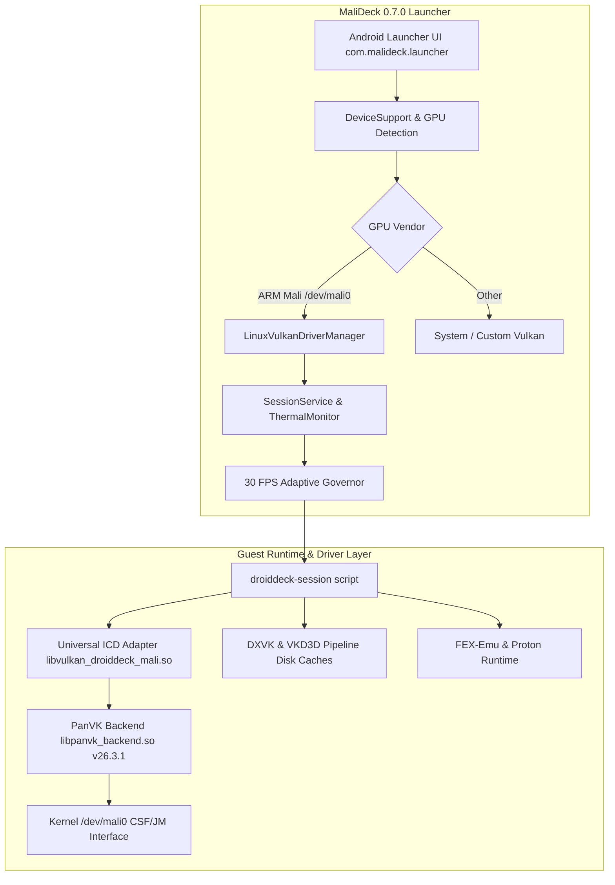

# MaliDeck 0.7.0 Upgrade & Mali Performance Implementation Plan

> **For agentic workers:** REQUIRED SUB-SKILL: Use superpowers:subagent-driven-development (recommended) or superpowers:executing-plans to implement this plan task-by-task. Steps use checkbox (`- [ ]`) syntax for tracking.

**Goal:** Upgrade MaliDeck from DroidDeck 0.6.0 to DroidDeck 0.7.0 upstream base, upgrade the bundled Mali PanVK runtime driver to `panvk-kbase-v26.3.1`, strip all Adreno/Turnip APK assets, and tune aggressive performance configurations for Mali GPUs.

**Architecture:** Merge upstream tag `0.7.0` into the `mali` branch while preserving custom MaliDeck rebrand, adaptive 30 FPS performance engine, and external games picker. Repackage the universal Mali driver using the latest `libvulkan_panfrost-glibc-aarch64.so` from PanVK-kbase `v26.3.1` (providing up to 140% higher D3D11 framerates, working D3D12/VKD3D, and 160MB memory savings) alongside the universal ICD adapter. Strip embedded Adreno Turnip `.tzst` archives from the APK to deliver a lean, Mali-exclusive gaming launcher.

**Architecture Diagram:**

**Tech Stack:** Android (Kotlin, Java), Bash (session scripts & governor), Vulkan (PanVK-kbase, Mesa 26.3.0-devel), C (Mali ICD adapter), Wine/Proton, DXVK, FEX-Emu.

**Spec:** User specification requesting MaliDeck upgrade to 0.7.0, driver upgrade, Adreno asset removal, and Mali performance maximization.

---

## Global Constraints

- NEVER force-push, rewrite, or delete published git history, tags, or branches. Add new commits only.
- DO NOT commit release keystores or passwords (keystores exist only in CI secrets).
- Ensure `applicationId` remains `com.malideck.launcher` and attribution to DroidDeck (GPL-3.0) is maintained.
- All Adreno/Turnip prebuilt graphics archives must be stripped from `app/src/main/assets/graphics_driver/`.
- Maintain honest hardware reporting in documentation and test matrices.

---

## Review Focus

1. Upstream 0.7.0 merge integrity: Verify all 0.7.0 core improvements (memory compression, input fixes, session bus) are intact without regressions in MaliDeck features.
2. Adreno stripping: Confirm no Adreno driver archives remain in `assets/graphics_driver/`.
3. PanVK 26.3.1 packaging: Verify `libpanvk_backend.so` SHA-256 matches upstream release and `meta.json` correctly declares driver metadata.
4. 30 FPS Adaptive Governor: Verify `droiddeck-governor` properly handles resolution scale stepping under load.
5. Build verification: Ensure Gradle build and CI workflow configurations pass cleanly.

---

## Tasks

### Task 1: Merge Upstream DroidDeck 0.7.0 and Resolve Conflicts

- [ ] **Step 1:** Fetch upstream tag `0.7.0` (`2bd7df5e1ad3aed25a5c9ddede1120a7c2f0b104`) on branch `mali`.
- [ ] **Step 2:** Start merge `git merge 0.7.0` and inspect conflicting files.
- [ ] **Step 3:** Resolve conflicts in `app/build.gradle` (preserve `com.malideck.launcher`, shrink/minification, disable verifyRuntimeInputs).
- [ ] **Step 4:** Resolve conflicts in `app/src/main/java/com/droiddeck/launcher/gpu/LinuxVulkanDriverManager.java` (integrate 0.7.0 changes while preserving safe Mali import and CSF checking).
- [ ] **Step 5:** Resolve conflicts in `app/src/main/java/com/droiddeck/launcher/session/SessionService.kt` (retain thermal monitor and governor start hooks).
- [ ] **Step 6:** Resolve conflicts in `tools/linuxfs/overlay/usr/local/bin/droiddeck-session` (preserve `/dev/mali0` detection, Mali check, and governor invocation).
- [ ] **Step 7:** Resolve conflicts across localized strings (`res/values*/strings.xml`) preserving "MaliDeck" branding.
- [ ] **Step 8:** Commit the merge commit with a descriptive message.

---

### Task 2: Strip Adreno / Turnip Assets and Enforce Mali-Only Scope

- [ ] **Step 1:** Delete any re-introduced Adreno Turnip archives (`app/src/main/assets/graphics_driver/adrenotools-turnip*.tzst`).
- [ ] **Step 2:** Verify `app/src/main/assets/graphics_driver/` contains no proprietary or Adreno-specific binary blobs.
- [ ] **Step 3:** Update `DriverArchivePolicy.java` to bypass Turnip default extraction and prioritize Mali drivers.
- [ ] **Step 4:** Commit Adreno removal: `chore(assets): strip Adreno Turnip driver archives for Mali-exclusive build`.

---

### Task 3: Build & Package New Mali PanVK-kbase v26.3.1 Driver Kit

- [ ] **Step 1:** Download `libvulkan_panfrost-glibc-aarch64.so` from `zenithblue-oss/panvk-kbase-android` release `panvk-kbase-v26.3.1`.
- [ ] **Step 2:** Verify its SHA-256 matches `063bcf0cacd6605458f015392d4ea9333ce480ddffbb83ceeaee88523b123d9b`.
- [ ] **Step 3:** Create staging directory for the new driver kit `MaliDeck-PanVK-Universal-v0.2.0.zip`.
- [ ] **Step 4:** Place `libvulkan_panfrost-glibc-aarch64.so` as `libpanvk_backend.so`.
- [ ] **Step 5:** Copy universal adapter `libvulkan_droiddeck_mali.so` and `licenses/LICENSE.adapter`.
- [ ] **Step 6:** Update `meta.json` with driver version `26.3.1`, build `122i`, Mesa `26.3.0-devel`, and computed SHA-256 hashes.
- [ ] **Step 7:** Update `NOTICE.txt` with credits to `zenithblue-oss/panvk-kbase-android`, `Mesa`, `jdmg28`, and `DroidDeck`.
- [ ] **Step 8:** Create ZIP package and verify its internal layout.

---

### Task 4: Aggressive Performance Tuning for Mali GPUs

- [ ] **Step 1:** Update `tools/linuxfs/overlay/usr/local/bin/droiddeck-session` with optimized Mali environment variables:
  - `MESA_SHADER_CACHE_DIR` persistent cache path
  - `MESA_SHADER_CACHE_MAX_SIZE=2G`
  - `DXVK_STATE_CACHE=1` and `DXVK_STATE_CACHE_PATH`
  - `VKD3D_SHADER_CACHE_PATH` for D3D12
  - `PAN_MESA_DEBUG=sink_sync` optimization toggle
- [ ] **Step 2:** Update `droiddeck-governor` to include proactive thermal downscaling and frametime smoothing.
- [ ] **Step 3:** Commit performance optimizations: `perf(mali): tune shader caches, DXVK state caches, and governor pacing`.

---

### Task 5: Documentation, Provenance & Release Manifest Updates

- [ ] **Step 1:** Update `README.md` to reflect MaliDeck 0.7.0, PanVK v26.3.1 driver details, and expanded GPU family support.
- [ ] **Step 2:** Update `SOURCE.md` with upstream commit `2bd7df5e` (DroidDeck 0.7.0) and driver release `panvk-kbase-v26.3.1`.
- [ ] **Step 3:** Update `CREDITS.md` with latest PanVK-kbase updates.
- [ ] **Step 4:** Push `mali` and `main` branches to `origin`.
- [ ] **Step 5:** Run link verification script and report complete results.
